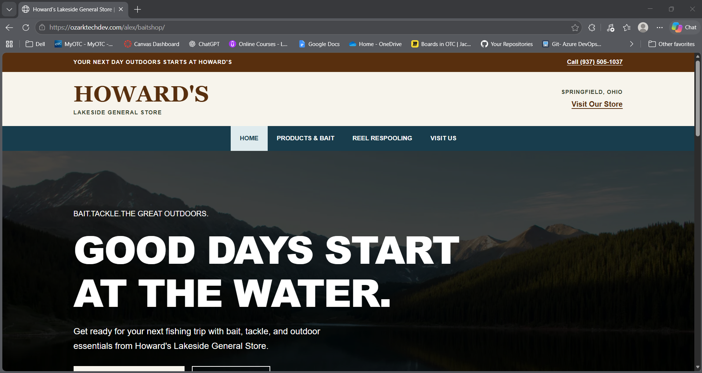

# Live Bait Shop Redesign

**Name:**Alex Tuck
**Class:**CIS130
**Project:** Live Bait Shop

### Project Description: 
This is a redesign of an already existin website for Howard's Lakeside General Store. The project was to redesign the website and have 2 working pages, a responsive layout (I chose to use cards and media queries), multimedia (a video), professional css (unsure on specific defenition as to how this is accomplished), validates (checked), and published live. 

### Link to live project URL:
https://www.ozarktechdev.com/alex/baitshop/

### Screenshot of homepage:
